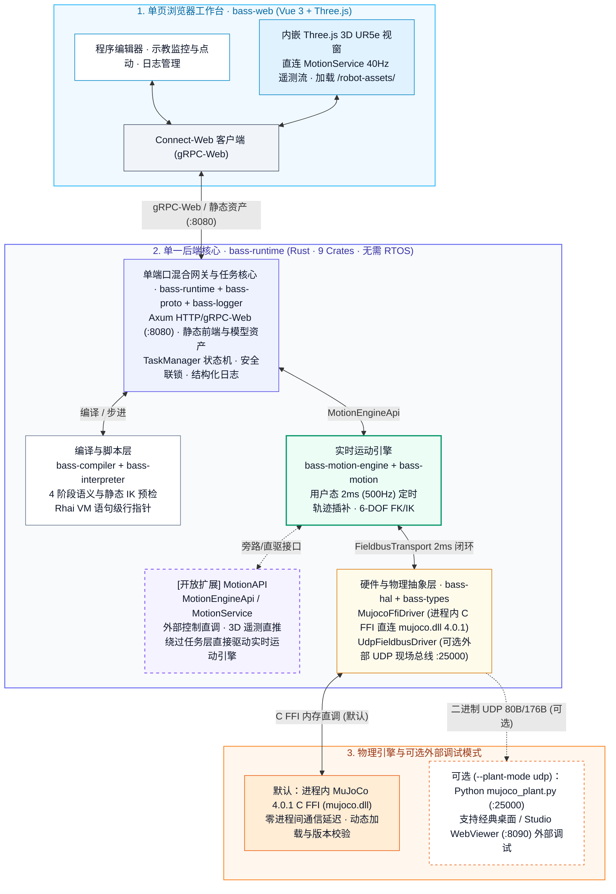

# Bass 1.1 — 一体化工业机器人控制器与 MuJoCo 4.0.1 实时仿真平台

**Bass 1.1** 是一款轻量级 6 轴（UR5e）工业机器人**软控制器**（**纯用户态运行，无需 RTOS**）与物理仿真一体化平台：后端单进程 **`bass-runtime`** 通过 **C FFI 直接内嵌 MuJoCo 4.0.1 (`mujoco.dll`)** 物理引擎，由 **2ms（500Hz）实时运动引擎 (`bass-motion-engine`)** 直接驱动物理世界与闭合伺服控制，同时在 `:8080` 提供 **gRPC / gRPC-Web 网关**与静态资产托管；前端仅保留**单一网页工作台**（Vue 3 + Connect-Web + **Three.js 3D 机械臂视窗**），既能通过 `TaskManager` 调度 Rhai 编程示教与行指针跟踪，又能直接订阅 `MotionService` 遥测流驱动 3D 显示与外部开放控制。

> **开箱即用**：编译产物、`mujoco.dll`、集成 3D 视窗的单页前端与 UR5e 实例均已打包至 [`runtime/`](runtime/)，默认单进程模式**无需安装 Python、Rust、Node.js 或 RTOS** 即可独立运行（详见 [`runtime/README.md`](runtime/README.md)）。

## 分层架构



## 架构边界与生产适用性说明

> [!WARNING]
> **单进程一体化架构（默认 `--plant-mode ffi`）主要面向桌面仿真验证、教学与快速原型开发，不可直接用于真实工业现场生产。**

在 **Bass 1.1** 默认模式下，Web 网关、脚本编译/解释器、实时运动引擎与 `mujoco.dll` 全部运行在同一个 OS 进程内（进程内内存通道 + C FFI **0 IPC** 直调）。虽然这带来了极简部署与极低仿真延迟，但也意味着以下生产级局限：

- **故障域未隔离（命运共享）**：同一进程内的所有模块共享虚拟地址空间；一旦 C/C++ FFI 侧（如 `mujoco.dll` 异常）发生段错误/访问违例，或实时线程出现未捕获 panic / 内存耗尽，整个 `bass-runtime.exe` 会连带网关与安全逻辑一并退出，而业务层/脚本层的异常虽然已做边界捕获（`CompileFailure`、`StepOutcome::Error`、`STAT_FAULT`），仍无法兜底 OS 级崩溃。
- **非实时负载耦合与安全链路独立性**：浏览器静态资源、gRPC/gRPC-Web 并发、JSONL 磁盘日志与运动控制共享用户态进程资源且未运行在硬实时 RTOS 上，真实产线通常需要物理安全继电器 / STO、独立安全监控核与硬件现场总线（如 EtherCAT 主站进程或专用实时核）。
- **生产 / 容错隔离演进路径**：利用 `bass-hal` 预留的 `FieldbusTransport` 抽象与 `--plant-mode udp`（`-ExternalSim`），可将物理仿真或硬件从站拆回独立进程/独立控制器运行——当外部被控端崩溃或失联时，实时运动引擎仍保持存活，并在 `150ms` TxPDO 超时后触发 `SafetyTripped` 安全抱闸。

## 快速开始

### 1. 克隆项目并一键启动（默认内置 C FFI 模式）

```bash
git clone <your-repo-url>/bass.git
cd bass
```

- **一键启动（推荐）**：双击 [`runtime/启动Bass.bat`](runtime/启动Bass.bat)，会启动单进程 `bass-runtime.exe`（内置 MuJoCo 4.0.1 `mujoco.dll`）并自动打开单一浏览器工作台 **`http://127.0.0.1:8080`**。
- **命令行启动**：
  ```powershell
  .\runtime\start_bass.ps1                         # 默认：单进程内置 FFI + 浏览器内嵌 3D 视窗
  .\runtime\start_bass.ps1 -NoBrowser -HttpPort 8080 # 自定义端口且不自动弹出浏览器
  ```

进入 **`http://127.0.0.1:8080`** 后：在顶部切换 **`AUTO`** -> 点击 **`DRIVES ON`** 上电 -> 选择 `MoveSquare.rhai` 或 `PickAndPlace.rhai` -> 点击 **`▶ RUN`**（或在 `MANUAL` 模式下点 **`⏭ STEP`** / 示教点动），即可在页面左侧看到行指针跟踪，在右侧常驻 **3D 机械臂视窗**中实时观察 UR5e 物理运动与 TCP 轨迹。

### 2. 可选：外部 Python MuJoCo 4.0.1 调试模式

仅当你希望单独启动 Python MuJoCo 视窗或 MuJoCo Studio WebViewer 进行离线/对照调试时，才需要配置 **Python 3.11+**：

```powershell
pip install -r runtime/requirements.txt
python -c "import mujoco, mujoco.studio, numpy; print('MuJoCo:', mujoco.__version__, 'NumPy:', numpy.__version__)"

.\runtime\start_bass.ps1 -ExternalSim          # 外部 Python MuJoCo 桌面视窗 + UDP
.\runtime\start_bass.ps1 -StudioWeb            # 外部 Python MuJoCo Studio WebViewer (:8090) + UDP
.\runtime\start_bass.ps1 -ExternalSim -Headless # 外部 Python 无头仿真 + UDP
```

## 给 AI 助手：自动化安装与配置指南

> 如果你是 AI 编码助手，请按以下非交互流程完成 **Bass 1.1** 的环境检查、启动与验证：

1. **前置检查（Windows x64）**：
   - `runtime/bin/bass-runtime.exe`、`runtime/bin/mujoco.dll` 与 `runtime/web/` 已就绪，**默认 C FFI 运行无需安装 Rust、Node.js 或 Python**（仅二次开发源码或运行 Python 外部测试才需对应环境）。
   - 确认端口 `8080` 未被占用。
2. **后台启动与健康检查**：
   - 在后台运行：`powershell -NoProfile -ExecutionPolicy Bypass -File .\runtime\start_bass.ps1 -NoBrowser -HttpPort 8080`。
   - 校验就绪：`GET http://127.0.0.1:8080/` 与 `GET http://127.0.0.1:8080/robot-assets/config/robot_model.json` 返回 HTTP `200`，以及 `POST /bass.controller.v1.ControllerService/GetState` 返回 `plant_online=true`。
3. **测试套件**：
   - Rust 全工作区单测：`cargo test --manifest-path src/bass-core/Cargo.toml --workspace`
   - Python MuJoCo 4.0.1 兼容与场景测试：`python -m pytest src/tests/test_sim_mujoco4.py`
   - 前端类型与构建检查：`cd src/bass-web && npm run build`

## 目录与源码构建

```text
bass/
├── LICENSE                         # MIT 开源协议
├── pyproject.toml                  # Python 依赖与测试配置
├── runtime/                        # 免源码独立运行包（启动Bass.bat、bin/bass-runtime.exe、bin/mujoco.dll、web/、sim/、instances/）
└── src/                            # 开发源码（proto/、bass-core/、bass-web/、tests/）
```

<details>
<summary>二次开发：Rust / 前端构建命令</summary>

```powershell
# 1. 运行 Rust 单测并更新 runtime/bin/bass-runtime.exe
cargo test --manifest-path src/bass-core/Cargo.toml --workspace
cargo build --release --manifest-path src/bass-core/Cargo.toml -p bass-runtime
Copy-Item src/bass-core/target/release/bass-runtime.exe runtime/bin/bass-runtime.exe -Force

# 2. 重新生成 Protobuf 类型、构建前端并同步到 runtime/web/
cd src/bass-web
npm install
npm run gen:proto
npm run build
Remove-Item -Recurse -Force ../../runtime/web/assets -ErrorAction SilentlyContinue
Copy-Item -Recurse -Force dist/* ../../runtime/web/
```

</details>

## 开源协议

本项目主体代码基于 [MIT License](LICENSE) 开源；工作站实例内的 UR5e 三维模型资产遵循 BSD-3-Clause 协议（见 [`runtime/instances/default_cell/models/ur5e/LICENSE`](runtime/instances/default_cell/models/ur5e/LICENSE)），`mujoco.dll` 遵循 MuJoCo (Apache-2.0) 开源协议。
