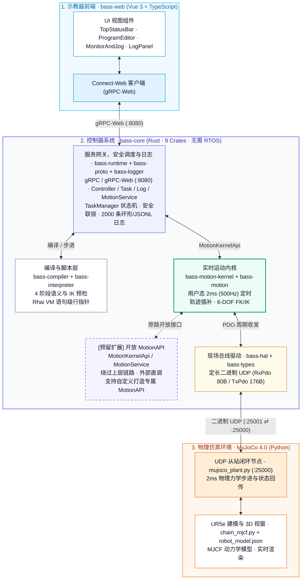

# Bass 1.0 — 工业机器人控制器系统与物理仿真平台

**Bass 1.0** 是一款轻量级 6 轴（UR5e）工业机器人**控制器系统**（**纯用户态运行，无需 RTOS**）与物理仿真平台：以 `:8080` **gRPC / gRPC-Web 服务端**驱动浏览器示教器，支持 Rhai 脚本解释与**代码行级运行指针跟踪**，并通过异步接口调度解耦的 **2ms（500Hz）运动内核**与 MuJoCo 4.0 物理闭环；运动内核同时预留绕过上层链路的开放式 **MotionAPI** 扩展口，便于外部系统直调或自定义开发。

> **免源码便携运行**：编译产物、前端界面、仿真脚本与示例配置均已打包至 [`runtime/`](runtime/)，无需安装 Rust、Node.js 或 RTOS，可单独复制独立运行（详见 [`runtime/README.md`](runtime/README.md)）。

## 分层架构



## 快速开始

### 第一步：克隆项目到本地

```bash
git clone <your-repo-url>/bass.git
cd bass
```

### 第二步：配置 MuJoCo 环境（必选）

> [!WARNING]
> **必须安装 MuJoCo！** 3D 物理场景与关节力矩反馈由独立 Python MuJoCo 进程驱动。**如果不配置 MuJoCo 环境，将无法显示 3D 物理环境，且控制器会因从站离线无法使能驱动器运行。**

确保已安装 **Python 3.10+** 并加入 `PATH`，执行以下命令安装并验证依赖：

```powershell
pip install -r runtime/requirements.txt
python -c "import mujoco, numpy; print('MuJoCo:', mujoco.__version__, 'NumPy:', numpy.__version__)"
```

### 第三步：启动与运行

- **一键启动（推荐）**：双击 [`runtime/启动Bass.bat`](runtime/启动Bass.bat)，会自动拉起 MuJoCo 3D 视窗与 `bass-runtime` 并打开浏览器。
- **命令行启动**：
  ```powershell
  .\runtime\start_bass.ps1                           # 默认：3D 物理视窗 + 自动打开浏览器
  .\runtime\start_bass.ps1 -Headless                 # 无头模式（无 3D 弹窗）
  .\runtime\start_bass.ps1 -NoBrowser -HttpPort 8080 # 自定义端口且不自动打开浏览器
  ```

打开 **`http://127.0.0.1:8080`**，依次切换 **`AUTO`** -> 点击 **`DRIVES ON`** 上电 -> 选择默认 `MoveSquare.rhai` 或 `PickAndPlace.rhai` -> 点击 **`▶ RUN`** 或 **`⏭ STEP`**，即可观察代码行指针 `▶` 与 3D 机械臂实时联动。

## 给 AI 助手：自动化安装与配置指南

> 如果你是 AI 编码助手，请直接按以下非交互流程完成 **Bass 1.0** 的环境检查、依赖安装、可用性验证与启动：

1. **前置检查（Windows x64）**：
   - 预编译控制核心（`runtime/bin/bass-runtime.exe`）与前端（`runtime/web/`）已就绪，**仅部署运行无需安装 Rust 或 Node.js**（只有修改 `src/` 源码才需要）。
   - 检查 `python --version`（需 `>= 3.10`）与 `pip --version`，并确认端口 `8080`（HTTP/gRPC-Web）、`25000`/`25001`（本地 UDP）未被占用。
2. **安装并验证 MuJoCo 依赖**：
   ```powershell
   pip install -r runtime/requirements.txt
   python -c "import mujoco, numpy; print('OK', mujoco.__version__, numpy.__version__)"
   ```
   - 若失败：排查 Python 版本与 pip 网络/镜像；**禁止在未安装 `mujoco` 时尝试启动**（会导致从站离线、驱动器无法使能）。
3. **启动与健康检查（避免同步终端卡死）**：
   - `start_bass.ps1` 会在前台持续守护进程直至退出，AI 请在**后台进程**启动：
     - **纯接口/无头校验**：`powershell -NoProfile -ExecutionPolicy Bypass -File .\runtime\start_bass.ps1 -Headless -NoBrowser -HttpPort 8080`，轮询 `GET http://127.0.0.1:8080/` 返回 HTTP `200`（或 `POST /bass.controller.v1.ControllerService/GetState` 返回 `200`）即就绪。
     - **用户桌面可视化（3D 视窗 + 浏览器）**：后台运行 `.\runtime\start_bass.ps1` 或提示用户双击 [`runtime/启动Bass.bat`](runtime/启动Bass.bat)，访问 `http://127.0.0.1:8080`。
   - 若修改了 Rust 控制核心源码，可执行 `cargo test --manifest-path src/bass-core/Cargo.toml --workspace` 运行内置单元测试。

## 目录与源码构建

```text
bass/
├── LICENSE                         # MIT 开源协议
├── pyproject.toml                  # Python 依赖与包配置
├── runtime/                        # 免源码独立运行包（启动Bass.bat、bin/、web/、sim/、instances/default_cell/）
└── src/                            # 开发源码（proto/、bass-core/、bass-web/）
```

<details>
<summary>二次开发：Rust / 前端构建命令（可选）</summary>

```powershell
# 1. 运行 Rust 单测并更新 runtime/bin/bass-runtime.exe
cd src/bass-core
cargo test --workspace
cargo build --release -p bass-runtime
Copy-Item target/release/bass-runtime.exe ../../runtime/bin/bass-runtime.exe -Force

# 2. 重新生成 Protobuf 类型、构建前端并同步到 runtime/web/
cd ../bass-web
npm install
npm run gen:proto
npm run build
Copy-Item -Recurse -Force dist/* ../../runtime/web/
```

</details>

## 开源协议

本项目主体代码基于 [MIT License](LICENSE) 开源；其中工作站实例内的 UR5e 三维模型资产遵循原版权方协议，见 [`runtime/instances/default_cell/models/ur5e/LICENSE`](runtime/instances/default_cell/models/ur5e/LICENSE)（BSD-3-Clause）。

---

欢迎对工业机器人控制器系统、编译器、实时插补及 MuJoCo 物理仿真感兴趣的朋友克隆本项目或基于 `runtime/` 包进行改造、扩展与测试！
